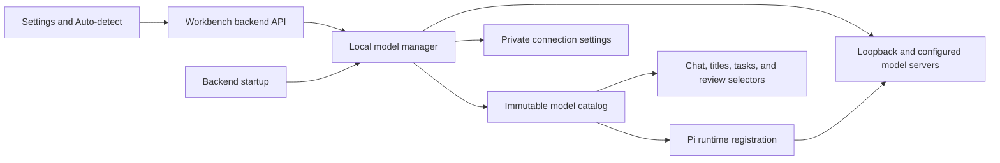

# Support local model servers

Add automatic discovery and settings-based configuration for model servers running on the same machine as the OK Workbench backend, including Linux. Let users rescan servers and model inventories without restarting the backend.

**Status:** Proposed implementation specification, 2026-09-28. This document does not describe an implemented feature. Implement every **must** requirement and acceptance criterion. Private helper names can change; preserve the public contracts and behavior below. The implementation target is GPT-6-Luna, so follow the phases in order and use the named criteria as a completion checklist.

## Before you begin

- Use the Node.js version required by `package.json`, CommonJS for backend modules, and the existing plain JavaScript frontend. Use built-in HTTP facilities; this feature does not require another model SDK.
- Read `src/server.js`, `src/pi-harness.mjs`, `src/public/app.js`, `src/public/index.html`, `src/public/app.css`, `src/workspace-review.js`, and the provider checks in `validateWorkspaceReviewSettings()`.
- Read `test/chat.test.mjs`, `test/pi-harness.test.mjs`, `test/http-security.test.mjs`, `test/workspace-review-http.test.mjs`, and [the threat model](THREAT-MODEL.md).
- Read the installed Pi package's `docs/custom-provider.md` and `dist/core/model-runtime.js`. Confirm its registration and authentication APIs against the installed version before implementing them.
- Edit `src/`, not generated `dist/`. `scripts/build.mjs` already copies source modules into the distribution.
- Discovery and text generation must not require provider credentials, a GPU, executable discovery, or installation of Ollama on the Workbench machine. Users must start their inference server themselves.

### Understand the current integration

| Existing location | Current behavior | Required integration |
| :--- | :--- | :--- |
| `configuredPiProviders()` in `src/pi-harness.mjs` | Creates a fresh `ModelRuntime`; lists providers with available authenticated models. | Register current local models in the runtime through a shared helper. |
| `runPiTurn()` in `src/pi-harness.mjs` | Creates another runtime; resolves the provider/model before creating a tool-capable agent session. | Register the same local model definitions before lookup. |
| `providerCatalog()` in `src/server.js` | Combines Pi providers and the environment-configured `compatible` provider. | Append available local generative providers with stable identities. |
| `providerStream()` in `src/server.js` | Routes Pi turns and an optional direct HTTP path. | Route new local generative providers through Pi. |
| `chatStatus()` and `/api/chat/status` | Return the catalog and defaults. | Preserve existing fields and expose local connection metadata as specified below. |
| Chat settings dialog and `loadChatStatus()` | Manage cloud credentials, runtime settings, and model selectors. | Add local connection controls and refresh all selectors after a rescan. |
| `WorkspaceReviewCoordinator` | Calls the shared provider stream without workspace tools. | Allow suitable local generative models under the existing context and validation rules. |

## Define the support boundary

“Local” refers to the inference server, not a CLI installed on the user's computer. Automatic discovery probes the **backend machine**. If the backend and browser run on different machines, browser loopback is irrelevant.

Linux on the same host is a required first-class target. A server bound to `127.0.0.1`, `::1`, or `0.0.0.0` on Linux must work without another host on the network. A containerized server works when its port is published to the backend host. An unpublished container port or a service in another network namespace requires an explicitly reachable URL; do not inspect Docker or guess bridges.

Support explicitly configured servers on another machine as well. Version 1 accepts private network IP literals; it does not scan the LAN. Explain this distinction in settings help text.

### Support these server families

The default ports below define Workbench's discovery candidates. A matching port alone does not prove a product's identity.

| Server family | Default candidate | Discovery | Inference and use |
| :--- | :--- | :--- | :--- |
| Ollama | `http://127.0.0.1:11434` | `GET /api/tags`; bounded `POST /api/show` for model metadata. | OpenAI Chat Completions at `/v1/chat/completions`, through Pi. |
| Ollaya | `http://127.0.0.1:11435` | `GET /api/tags`; metadata through `/api/show`. | Native `POST /api/decide`; decision models only. |
| LM Studio or compatible server | `http://127.0.0.1:1234/v1` | `GET /v1/models`. | OpenAI Chat Completions through Pi; default label **LM Studio / compatible (1234)**. |
| OpenAI-compatible server | `http://127.0.0.1:8080/v1` | `GET /v1/models`. | Covers llama.cpp, llamafile, LocalAI, and other compatible servers. |
| OpenAI-compatible server | `http://127.0.0.1:8000/v1` | `GET /v1/models`. | Candidate for vLLM and other compatible servers. |
| Custom server | User-supplied URL and protocol | Adapter for the selected protocol, or manual model records. | Supports custom ports, multiple instances, authentication, and reverse proxy prefixes. |

Ollama documents model listing and OpenAI-compatible streaming and tools. LM Studio documents `/v1/models` at port 1234. llama.cpp documents model listing and compatible chat; LocalAI also exposes compatible APIs. These are the basis for the generative adapters. See [Ollama model listing](https://docs.ollama.com/api/tags), [Ollama compatibility](https://docs.ollama.com/api/openai-compatibility), [LM Studio model listing](https://lmstudio.ai/docs/developer/openai-compat/models), [llama.cpp server documentation](https://github.com/ggml-org/llama.cpp/blob/master/tools/server/README.md), and [LocalAI documentation](https://github.com/mudler/LocalAI/blob/master/README.md).

Ollaya returns typed answers to questions about supplied state. Its `/v1/models` response is **not** the OpenAI model-list format, and it does not generate chat text. Detect and configure it as a decision provider; never route its models into Chat Completions. See [Ollaya API documentation](https://ollaya.dev/docs/api).

### Define Ollaya completion precisely

This feature must discover Ollaya, list its models in settings, save custom Ollaya connections, and provide a tested backend decision transport helper. Implement `requestLocalDecision({ connectionId, model, state, questions, signal })` in the new module. It resolves a saved/current connection, calls `/api/decide` with `stream: false`, validates the documented `model`, `answers`, and `usage` response envelope, and returns typed data. Reject malformed responses and `state_truncated: true`; preserve cancellation and timeouts. Limit request and response bodies to 1 MiB and default the request deadline to 120 seconds. Do not retry decisions automatically.

Do not create a browser endpoint that submits workspace evidence to this helper. No existing Workbench feature currently consumes decision models. Show **Decision models — available for decision integrations; cannot be used for chat**. Integrating typed decisions into workspace assessment belongs to the separate [Jev assessment specification](OK-WORKBENCH-JEV-WORKSPACE-ASSESSMENT-SPEC.md), which is also proposed. This transport must not enable that integration or trigger decisions automatically.

### Exclude these operations

Version 1 does not install servers, download models, start or stop daemons, load models during discovery, read model directories, detect GPUs, change firewall rules, scan arbitrary ports, run CLI commands, implement embeddings or image generation, or enable server-side agents/MCP tools. Generation can cause the selected inference server to load its model normally.

## Implement discovery and connection state

Create `src/local-models.js` with protocol adapters, URL validation, connection persistence, bounded probes, immutable catalog snapshots, and injectable HTTP/clock/candidate dependencies for tests. Keep one manager per backend process; pass snapshots to the harness rather than implementing a second scanner there.



### Discover without configuration

1. After loading application state, start one automatic scan. Start the HTTP listeners without waiting for network probes. Start or resume automatic workspace reviews after the initial scan settles, so a saved local review selection is not rejected merely because startup discovery is pending.
2. For each default candidate, try IPv4 loopback first. If no valid protocol response arrives, try the equivalent `http://[::1]:port` URL. Keep a single default candidate identity across address-family fallback. On a `401` or `403`, record **Authentication required** and do not try to bypass authentication using another address.
3. Probe explicitly configured enabled connections as well. Never probe a disabled connection or a suppressed default candidate.
4. Validate status, JSON structure, and model identifiers. Accept an empty valid inventory as **No models**. Reject HTML, unrelated JSON, redirects, invalid IDs, and oversized responses. Do not infer a product from its port or an arbitrary banner.
5. Fetch metadata only through known adapter endpoints. Ollama/Ollaya `/api/show` is a metadata request and may use `POST`; do not send prompts, workspace content, or generation requests during discovery. Inspect at most 32 models per connection. Beyond that limit, retain listed models with unknown metadata.
6. Deduplicate and sort models by exact model ID. Replace the scan snapshot atomically, then publish a monotonically increasing `catalogRevision`.

Use a 1,500 ms total deadline per metadata/list request, including response body consumption; at most four concurrent requests; a 12-second total deadline per scan; a 1 MiB body limit per discovery response; at most 512 models per connection; and at most 16 explicitly saved connections. Abort outstanding requests at the scan deadline. Bound DNS/address handling as part of those deadlines. Scan work must not delay unrelated workspace HTTP requests.

If one probe fails, preserve results from other connections. A connection whose model-list request succeeds remains ready even if optional metadata requests time out. If the inventory probe fails or never starts before the total deadline, mark that connection unavailable with a sanitized reason. Preserve last-known models for display only; they must not remain selectable as available models. Every scan returns a complete status snapshot, even when some probes fail.

Normalize Ollama/Ollaya tags from `models[].name` (fall back to `models[].model`) and compatible inventories from `data[].id`. Reject an entire inventory containing invalid records rather than publishing a misleading partial list. If Ollama `/api/show` returns `capabilities`, expose workspace tools only when it includes `tools`; exclude embedding-only models when it lacks `completion`. When capabilities are absent, retain the model as generative with unknown tool support. Ollaya models always have kind `decision`. If compatible metadata explicitly marks a model as embedding-only or another non-text modality, exclude it from generative selectors; otherwise expose text generation with unknown tool support. Do not infer capability from a model's name. Treat absent or unfamiliar metadata as unknown.

Do not perform a full scan on every `/api/chat/status` request or chat turn. During the initial scan, status can return `localModels.scanState: "scanning"`; the frontend polls status once per second until it settles, then refreshes its selectors. Subsequent scans run only on **Auto-detect**, saving/enabling a connection, or the explicit test action below. There is no periodic scan in version 1.

### Keep identities stable

- Default IDs are `local:ollama`, `local:ollaya`, `local:lm-studio`, `local:compatible-8080`, and `local:compatible-8000`. These are connection IDs; generative connection IDs also serve as provider IDs.
- Custom IDs are `local:<UUID>`, generated by the backend once and retained across edits, model inventory changes, and restarts. Model IDs stay exactly as the server returns them, including tags, slashes, and quantization names.
- Canonicalize URL scheme/host casing, default ports, and trailing slashes. Treat `localhost` as the IPv4 default alias for identity checks, but use explicit address-family fallback for default probes.
- Reject a custom connection that duplicates an existing connection's protocol and canonical URL with `409 DUPLICATE_CONNECTION`. Editing a discovered default connection persists an override under its default ID. The resolved IPv6 URL of a discovered default also counts as that default's URL for duplicate checks.
- Do not merge connections based on identical model lists. Two servers can expose the same model ID.
- Order existing providers as before; append available local generative connections in default candidate order, then custom connections by label and ID. Order each local model list by ID. This makes first-time defaults repeatable.

### Persist configuration privately

Use `local-model-connections.json` in `CHAT_STATE_DIR`, outside the workspace. Use the existing atomic write pattern and owner-only permissions. Serialize mutations to prevent concurrent saves from losing changes. Persist configuration and suppression; keep discovery snapshots in memory.

The file has `schemaVersion: 1`, `connections: []`, and `suppressedDefaultIds: []`. Persist only explicitly added connections and overrides to default connections. Removing a default override restores its default settings; disabling a default persists its ID in `suppressedDefaultIds`. Deleting a custom record removes it permanently. After a restart, disabled defaults must remain disabled.

| Configuration field | Type | Required | Rules |
| :--- | :--- | :--- | :--- |
| `id` | string | Backend-generated | Stable connection identity; never accept a caller-chosen new ID. |
| `label` | string | Yes | Trimmed, 1–80 characters; render as text. |
| `protocol` | string | Yes | `ollama`, `ollaya`, or `openai-compatible`. LM Studio uses the compatible protocol. |
| `baseUrl` | string | Yes | At most 2,048 characters. Native protocols use a server root/prefix; compatible URLs end at the API prefix, commonly `/v1`. |
| `enabled` | boolean | Yes | Controls availability and probing. Default `true` on creation. |
| `apiKey` | string | No | Write-only optional bearer token, at most 16,384 characters. Omitted on edit preserves the key; `null` clears it; blank strings are invalid. |
| `modelMode` | string | Yes | `discover` or `manual`; default `discover`. |
| `models` | array | For `manual` | 1–512 unique records, each with `id` and optional `label`, `contextWindow`, `maxOutputTokens`, and `supportsTools`. |
| `modelOverrides` | array | No | For discovered IDs: metadata overrides with the same fields. Never create a selectable missing model through an override. |

Reject unknown fields, invalid enums, wrong JSON types, control characters in IDs/labels, duplicate model IDs, and unknown connection IDs. IDs contain 1–512 characters. Optional token limits are integers from 256 through 2,097,152; if both limits exist, `maxOutputTokens` must be less than `contextWindow`. `supportsTools` accepts a boolean only and is invalid for Ollaya. For Ollaya, reject output-token settings because decision models do not generate output tokens.

If the file is malformed or has an unsupported schema version, preserve it, surface a settings error, and continue default discovery and cloud-provider operation. Do not silently overwrite it. Block configuration mutations until the user repairs the file; **Auto-detect** remains usable. A missing file represents empty configuration.

### Validate URLs and credentials

Accept `http:` and `https:` with `localhost`, loopback IP literals, RFC 1918 IPv4 literals, or IPv6 unique local addresses. Require an explicit port unless using the scheme's default. Reject URL userinfo, query strings, fragments, unspecified destinations such as `0.0.0.0`, multicast, link-local addresses, public addresses, and other DNS names in version 1. Reject Workbench's own application and asset ports on loopback to avoid self-probing. Users configuring a LAN server enter its private IP address.

Preserve a reverse proxy path prefix. Append `/api/tags`, `/api/show`, or `/api/decide` to a native root/prefix; append `/models` and `/chat/completions` to a compatible API prefix. Normalize each join with exactly one slash. Never silently append a second `/v1`.

Reject redirects for discovery, decisions, and generation. Preserve ordinary TLS certificate validation. A saved key applies only to its connection. Do not forward cloud keys or global `OPENAI_API_KEY` values to local endpoints. Do not send authorization headers to unauthenticated local servers. The Pi API may require an internal placeholder key; if so, keep that placeholder internal and suppress its authorization header.

The installed Pi legacy configuration interprets some key strings as commands or environment interpolation. Treat all user-entered secrets as literal values: use a native provider auth resolver or the runtime's literal credential API with registration that cannot evaluate the key. Do not pass raw saved secrets to configuration interpolation. Include keys containing `!`, `$`, and `${...}` in regression coverage.

Never return secrets or key previews in responses, store them in browser storage, include them in tool worker environments, or log raw upstream error bodies. Public connection records expose `hasApiKey: boolean` only. Sanitize errors to a bounded human-readable message and a code.

Automatic detection confirms an API endpoint, not guaranteed offline inference. Ollama can expose cloud-backed models through a local server. Exclude models advertised as cloud/remote, including `:cloud` IDs or nonempty remote-host metadata, from this feature's selectors and show their exclusion in settings. Do not claim that unknown compatible proxies guarantee offline execution. Display **Local endpoint; inference location depends on server configuration** for generic connections.

## Integrate local generation with Pi

Create one shared runtime-registration helper in `src/pi-harness.mjs`. Both `configuredPiProviders()` and `runPiTurn()` must call it with a snapshot supplied by the server. `runPiTurn()` must receive the exact selected connection/model definition captured for that turn; it must not resolve a newly edited endpoint midway through generation.

Register `openai-completions` models with the connection's effective API URL, exact model ID, text input support, discovered/overridden limits, and zero provider cost metadata. The zero cost values are Pi bookkeeping, not a promise about a proxy's billing. For compatible adapters, use `max_tokens`, disable `store` and developer-role assumptions, and do not request unsupported reasoning effort or streaming usage options. Confirm the corresponding Pi compatibility fields against the installed package.

The installed schema currently exposes `compat.maxTokensField`, `compat.supportsStore`, `compat.supportsDeveloperRole`, `compat.supportsReasoningEffort`, and `compat.supportsUsageInStreaming`. Set these to `"max_tokens"`, `false`, `false`, `false`, and `false`, respectively, for version 1 local registrations. Do not add arbitrary frontend-configurable compatibility flags.

Keep the public model metadata explicit:

| Field | Rule |
| :--- | :--- |
| `contextWindow` | Effective runtime context from explicit override or reliable server metadata; otherwise `null`. A model's maximum trained context alone does not prove its server's active context. |
| `maxOutputTokens` | Explicit override or reliable server metadata; otherwise `null`. |
| `supportsWorkspaceTools` | `true` only when adapter metadata reports tool support or the user explicitly enables it. Unknown tool support becomes `false`. |
| `supportsSteering` | `true` for generative models routed through Pi's existing steering implementation. |
| `thinkingLevels` | Empty in version 1; do not infer supported effort values from the model name. |
| `reviewTier` | `unverified` unless the existing tier table explicitly recognizes that provider/model pair. |
| `kind` | `generative` or `decision`; decision records appear only in local settings. |

If Pi requires numeric limits when the public context is unknown, use conservative internal defaults of 4,096 context tokens and 1,024 output tokens, bounded by any known limit. Do not publish these fallback values as discovered metadata. Prefer the effective override over metadata. Apply the same effective limits to registration, request construction, and review validation.

For models with tool support, use the existing custom tools, project capabilities, approval rules, abort handling, steering callbacks, and sandbox worker. Do not implement a parallel tool executor. For models without known tool support, create a text-only Pi turn with no workspace tools and show **Text only — workspace file tools unavailable** by the model selector. Titles and other existing no-tools calls remain available. Never serialize tools in a text-only request.

Local models must appear in chat, title generation, task model selection, and eligible review model selection. For local reviews, require a known effective context that satisfies `reviewContextTokensRequired()` and the existing below-recommended-model acknowledgment. Unknown context blocks review selection with instructions to configure it. Preserve review JSON validation, response limits, max-token enforcement, scheduling limits, and cancellation. Do not extend review deadlines for slow local models in this feature.

Capture an immutable connection/model/auth snapshot at the start of each turn or review job. A rescan, edit, disable, or delete affects future requests; active requests finish or obey their existing cancellation signal. Reject a new request for an offline/deleted model clearly, before sending evidence. Never silently substitute a cloud provider, another server, or another model. Preserve saved provider/model choices and show an unavailable option until the user changes the selection.

The existing environment-configured `compatible` provider and its ID retain their behavior. New `local:*` providers always use Pi, including when the global direct-provider setting is enabled.

## Define the backend API

All new routes use the existing host-authority check and `assertChatRequest()`. Mutations require the existing CSRF header and accepted origin. Use JSON; no route accepts arbitrary headers or discovery targets outside saved/default connections.

| Method and route | Request | Response |
| :--- | :--- | :--- |
| `GET /api/chat/local-models` | None. Reads current state; does not trigger a scan. | `200` public snapshot. |
| `POST /api/chat/local-models/detect` | Empty object. | `200` completed public scan snapshot, including partial failures. |
| `POST /api/chat/local-models/connections` | Connection fields without `id`. | `201` `{ connection, catalogRevision }`; persist first, then probe this connection. An unreachable server is saved with its failure status. |
| `PUT /api/chat/local-models/connections/:id` | Full editable record; omitted `apiKey` preserves it. Default candidate IDs can receive overrides. | `200` `{ connection, catalogRevision }`; apply immediately and probe when enabled. |
| `POST /api/chat/local-models/connections/:id/test` | Empty object. | `200` `{ connection, catalogRevision }`; probe the enabled saved/default connection and refresh its inventory. |
| `DELETE /api/chat/local-models/connections/:id` | None. Only custom records or existing default overrides. | `200` public snapshot. A custom record disappears; a default override resets and is reprobed unless suppressed. |

To disable/enable a default, use `PUT` with `enabled`; implement suppression consistently with the persistence rules. **Test connection** uses saved settings. Users must **Save** an edited form before testing it. A disabled connection's test action returns `409 CONNECTION_DISABLED` and is disabled in the UI.

Example public snapshot (the sample model is a fixture ID):

```json
{
  "catalogRevision": 4,
  "scanState": "idle",
  "lastScanAt": "2026-09-28T10:00:00.000Z",
  "configurationError": null,
  "connections": [
    {
      "id": "local:ollama",
      "label": "Ollama",
      "protocol": "ollama",
      "baseUrl": "http://127.0.0.1:11434",
      "source": "detected",
      "enabled": true,
      "hasApiKey": false,
      "modelMode": "discover",
      "status": "ready",
      "lastCheckedAt": "2026-09-28T10:00:00.000Z",
      "error": null,
      "models": [
        {
          "id": "fixture-chat:latest",
          "label": "fixture-chat:latest",
          "kind": "generative",
          "available": true,
          "contextWindow": 32768,
          "maxOutputTokens": 4096,
          "supportsWorkspaceTools": true,
          "supportsSteering": true,
          "thinkingLevels": [],
          "reviewTier": "unverified"
        }
      ]
    }
  ]
}
```

Public records must also expose editable non-secret model configuration/overrides so settings can restore a saved form. `source` is `detected`, `configured`, or `override`. `status` is `ready`, `empty`, `offline`, `auth-required`, `invalid-response`, `timeout`, or `disabled`. Models can carry `available: false` and an exclusion reason. Suppressed/default candidates remain visible in settings, including candidates that have never been discovered.

Extend `/api/chat/status` with `localModels: { catalogRevision, scanState, lastScanAt }` and retain local model fields in `providers[].models`. Only available generative models enter that provider catalog. Do not drop local connection metadata through the existing `{ id, label, models }` projection if the frontend needs it; expose a `connectionId` and `source: "local"` for local providers.

### Coordinate scans and mutations

If a scan is running, concurrent detect requests join its promise and return the same completed revision; they do not start another scan. Serialize scans, connection probes, and configuration mutations through the manager. A save queued behind a scan probes after its mutation commits, so a stale scan cannot overwrite its result. Build snapshots before replacing the current reference. Do not mutate snapshots held by active requests.

In manual model mode, probe `GET /api/version` for native servers or `GET /models` for compatible servers. A `404`/`405` for the compatible model-list endpoint counts as reachable with manual models; show **Manual inventory — compatibility not verified**. Do not treat a `401`, `403`, timeout, or transport failure as healthy. An unrelated service at the configured URL remains the user's explicit configuration, and its first generation request must fail clearly if incompatible. Automatic discovery never uses this exception.

## Add settings controls

Add a **Local models** section to the existing chat settings dialog with **Auto-detect** and **Add connection** buttons. Use the existing visual style and accessible native form controls.

- Show default candidates and saved connections with label, endpoint, protocol, source, enabled state, status, last check, available model count, and model capability summaries. Absent defaults say **Not detected**; valid empty inventories say **Server found; no models available**.
- During a scan, disable **Auto-detect**, show **Detecting…**, set `aria-busy`, and announce completion through `aria-live="polite"`. Show a summary such as **Found 2 servers and 5 chat models; 1 decision server** and expose failures by connection.
- Provide **Edit**, **Enable/Disable**, and **Test connection**. Provide **Remove** for custom records and **Reset to detected defaults** for persisted default overrides. Disabling a discovered default must survive a rescan and restart.
- The add/edit form contains label, protocol, base URL, optional password-type API key, inventory mode, and manual model/metadata controls. Explain the expected URL prefix beside the field. Saving a blank key field preserves an existing key; provide a separate **Clear saved key** checkbox to send `null`.
- For a discovered model, allow a context/output limit override and explicit tool support override. Keep the detected and effective values distinguishable. Do not mark a manually supplied capability as verified.
- After detect/save/test/enable/disable/remove/reset, refresh status and all open model pickers without page reload. Preserve a valid selection; retain an unavailable selection visibly without rewriting stored preferences. Include title, task, and open review settings pickers.
- During an active turn, retain its existing progress display and streaming controls. Updating the available choices must not change the turn's captured provider or disable its cancel action.
- Keep settings errors inline, preserve unsaved form values on failure, and restore button states in `finally`. Use `textContent` for labels and error messages from model servers.
- State: **Auto-detect checks this backend's machine. For a server on another machine, add its private IP URL. Start the server and download models with its own tools.**

## Handle errors

Return `{ "code": "...", "error": "sanitized message" }` for request errors. Inventory failures appear in the connection's `error: { code, message }` and do not fail the entire detect request.

| Code | HTTP status or connection state | Required action |
| :--- | :--- | :--- |
| `INVALID_REQUEST` | 400 | Identify the invalid field; preserve saved state. |
| `INVALID_LOCAL_URL` | 400 | Explain allowed addresses and expected URL prefix. |
| `DUPLICATE_CONNECTION` | 409 | Direct the user to edit the existing connection. |
| `CONNECTION_NOT_FOUND` | 404 | Refresh settings; do not recreate the ID. |
| `CONNECTION_DISABLED` | 409 | Ask the user to enable the connection. |
| `LOCAL_AUTH_REQUIRED` | `auth-required` | Ask for a connection-specific key. |
| `LOCAL_SERVER_UNAVAILABLE` | `offline` | Show endpoint and suggest starting the server or checking the URL. |
| `LOCAL_DISCOVERY_TIMEOUT` | `timeout` | Suggest retrying **Auto-detect** or checking server health. |
| `INVALID_MODEL_LIST` | `invalid-response` | Identify incompatible discovery data without displaying raw response bodies. |
| `LOCAL_MODEL_UNAVAILABLE` | Generation validation | Preserve the selection and ask the user to rescan or choose an available model. |
| `LOCAL_CONFIG_INVALID` | Configuration error; mutations return 409 | Preserve the file; report how to repair/reset it manually. |
| `INVALID_DECISION_RESPONSE` | Decision helper error | Reject malformed or truncated typed results. |

Keep existing CSRF/authority error behavior. Preserve native upstream authentication/status information as bounded codes, not raw content. Do not classify Ollaya as an authentication or chat failure just because it has no generative models.

## Implement in phases

1. **Confirm integration contracts.** Inspect Pi's installed registration API, model schema, literal authentication, compatible request flags, and cancellation. Report any conflict with this spec before changing public behavior. Do not upgrade dependencies to avoid understanding the existing API.
2. **Implement connection storage and validation.** Add the module, stable IDs, default overrides/suppression, literal credentials, URL joining, and injected candidate definitions. Add unit coverage for the persistence and validation criteria.
3. **Implement probes and snapshots.** Add native and compatible adapters, metadata normalization, deadlines/body limits, concurrency control, startup scanning, and the decision helper. Verify failures independently of the UI.
4. **Integrate the catalog and runtime.** Register models in both Pi runtime creation paths; capture per-turn definitions; update status and review checks. Verify streamed text and a complete tool round trip.
5. **Implement settings and selectors.** Add CRUD, test/detect routes, settings controls, startup polling, and selection preservation. Exercise the browser behaviors below.
6. **Complete regression checks and documentation.** Add user instructions to `README.md` and `docs/README.md`: Linux same-host setup, default ports, custom endpoints, rescan, metadata/tool overrides, and the Ollaya boundary. Run the appropriate tests and build. Record acceptance results and any remaining limitation.

## Verify acceptance criteria

Use Node mock HTTP servers with ephemeral ports and injected candidates. Tests must run on Linux without a GPU, installed model runners, downloaded model weights, internet access, or services listening on the documented default ports. Keep tests deterministic; use injected deadlines/clocks where possible. Test configuration/network components separately from sandbox-dependent tool integration.

| ID | Given and action | Required result |
| :--- | :--- | :--- |
| AC-01 | A Linux same-host Ollama fixture exposes `/api/tags` and model details; no cloud credentials or local connection file exists; start Workbench. | Initial scan discovers it, chat becomes enabled, and its exact IDs appear without user configuration. |
| AC-02 | Repeat AC-01 with IPv6-only loopback, when IPv6 is available. | Fallback discovers the server once under the same default ID; no duplicate provider appears. Skip only with an explicit IPv6-unavailable reason. |
| AC-03 | LM Studio-compatible, llama.cpp-compatible, and generic compatible fixtures return valid `data: [{ id }]` inventories. | Each becomes selectable under its connection ID; generic servers receive a generic label rather than an invented brand. |
| AC-04 | Start Workbench without servers; subsequently start a fixture and click **Auto-detect**. | The new provider/model appears in every relevant picker, without backend restart or browser reload. |
| AC-05 | Add and remove fixture models, then rescan. | Newly listed models appear; removed models become unavailable; unchanged IDs and valid selections persist. |
| AC-06 | Rescan while one fixture hangs, one returns HTML, and one works. | The scan completes within its deadline, reports both failures, and retains the healthy provider. Ordinary workspace requests continue to respond. |
| AC-07 | Return an empty valid list, invalid model IDs, duplicates, more than 512 models, and a body over 1 MiB. | Empty is distinct from offline; duplicates normalize; invalid or over-limit inventories fail safely without expanding memory indefinitely. |
| AC-08 | Send two simultaneous detect requests. | One underlying scan runs; both return its same final revision. No orphaned probe remains after its deadline. |
| AC-09 | Add an unauthenticated compatible fixture at a custom port and save it. Restart Workbench. | It works immediately and remains configured after restart; no global API key is required. |
| AC-10 | Add two connections exposing the same model ID. Edit one URL or label. | Both providers remain distinct; the edited connection ID and saved model preferences remain stable. |
| AC-11 | Save a canonical duplicate URL, including trailing slash/default-port/localhost variants. | API returns 409 and creates no duplicate. Editing a detected default saves an override under its original ID. |
| AC-12 | Disable a detected default, rescan, and restart. Reset an override; remove a custom connection. | Disabled stays disabled and receives no probes; reset restores defaults; custom removal stays removed. |
| AC-13 | Configure a private LAN IP fixture through an injected HTTP transport; separately use a same-host Linux fixture with no LAN host. | Both supported paths resolve correctly; automatic discovery sends no LAN requests. Same-host operation has no dependency on another machine. |
| AC-14 | A fixture requires a bearer key; save a key, leave it unchanged on edit, replace it, then clear it. | Only its requests receive the literal key; preservation/replacement/clearing work; API responses, browser storage, logs, and worker environments contain no key. |
| AC-15 | Use keys containing command/interpolation metacharacters and configure invalid URLs, own-server ports, public/link-local destinations, or redirects. | No command or interpolation executes; forbidden URLs fail before HTTP; redirects fail without following them or forwarding credentials. |
| AC-16 | Configure a reverse proxy prefix and URLs with/without trailing slashes. | Listing and inference hit the exact intended paths; no missing prefix or doubled `/v1` occurs. |
| AC-17 | A compatible fixture omits streaming usage, splits SSE events across chunks, and streams text. Cancel a turn. | Pi renders ordered text, handles normal completion, and aborts the upstream request promptly; no cloud fallback occurs. |
| AC-18 | A tools-capable local fixture requests a permitted file read and then returns final text after receiving the tool result. | Existing Pi custom tools execute a complete round trip under the existing project/sandbox permissions. A denied path remains denied. |
| AC-19 | Select a model whose tool support is unknown or false. | Chat works as text-only, displays its limitation, creates no tool worker, and sends no tools. Enabling an explicit tool override makes later turns use existing tools. |
| AC-20 | Generate a title, use a task model, and select a review model from local providers. | Exact selected connection/model routes each call. Unknown/insufficient context blocks local review; adequate context plus acknowledgment permits it with existing validation/output limits. |
| AC-21 | Select an available model, then stop its server and rescan. | Saved choice remains visible as unavailable; a new turn fails clearly; no model, endpoint, or cloud provider is silently substituted. |
| AC-22 | During an active streamed turn, rescan and change/delete/disable its connection. | The active request retains its captured endpoint/key/model and cancel/steering controls; new turns use the committed catalog. |
| AC-23 | A connection save arrives while a scan is pending. | The committed configuration is not overwritten by stale probe results; final status matches the edited connection. |
| AC-24 | An Ollaya fixture exposes native tags and decision metadata. | Settings list decision models; no chat/title/task/review generative selector includes them; discovery makes no `/api/decide` call. |
| AC-25 | Explicitly call the decision helper with fixture state/questions; cancel it; then return malformed or truncated data. | The helper posts the documented body to `/api/decide`, returns valid typed data, propagates aborts, and rejects invalid/truncated responses. It never invokes tools or publishes a review. |
| AC-26 | A tags response includes local and advertised cloud-backed Ollama models. | Local generative models appear; cloud-backed models are excluded and explained. Generic endpoints do not display a guaranteed-offline claim. |
| AC-27 | Configure manual model IDs on a compatible server without `/models`; use wrong authentication and unreachable variants. | A reachable 404/405 allows manual inventory with the unverified notice; authentication/transport failures never become ready. |
| AC-28 | Start with corrupted config or an unsupported schema; perform concurrent saves; inspect file permissions. | Corruption is preserved and reported; cloud/default discovery works; mutations cannot overwrite corruption; valid saves are serialized and private. |
| AC-29 | Use the settings with keyboard only and a narrow viewport; make a scan/save fail. | Every control has a label, focus remains usable, status is announced, errors stay inline, and pending buttons restore correctly. |
| AC-30 | Existing authenticated cloud providers and the legacy `compatible` environment provider coexist with local models; toggle direct-provider mode. | Existing provider behavior and IDs pass regression tests; new local turns still use Pi. Browsing remains available with all servers absent. |
| AC-31 | Inspect requests during startup, rescan, and opening settings. | Only bounded inventory/metadata probes occur; no prompts, evidence, model downloads, daemon commands, or hidden decision calls occur. |
| AC-32 | During a review job with several provider calls, edit its local connection between calls. | Every call in that job uses the captured endpoint/key/model and effective limits; the next job uses the new configuration. Existing review cancellation and publication rules still apply. |

Use `test/local-models.test.mjs` for module fixtures, `test/local-models-http.test.mjs` for server lifecycle/routes, the existing harness/chat tests for Pi integration, and an appropriate browser test under `test/e2e/` for the settings/rescan flow. Do not rely on a live service as proof for an acceptance criterion. Run Linux tool integration with the repository's Bubblewrap prerequisites; report sandbox unavailability separately from local model connectivity.

The handoff must include a table marking every criterion as passed, failed, or blocked with its test/manual evidence. A discoverable provider that cannot execute a streamed turn is incomplete. A rescan that requires restarting or refresh loses the feature's central requirement.

## What's next

After all criteria pass, document any server-specific compatibility limitations and supported fixture contracts. Extend Ollaya into actual assessment consumers only through the separate Jev assessment specification and its evidence, consent, and budget requirements.
