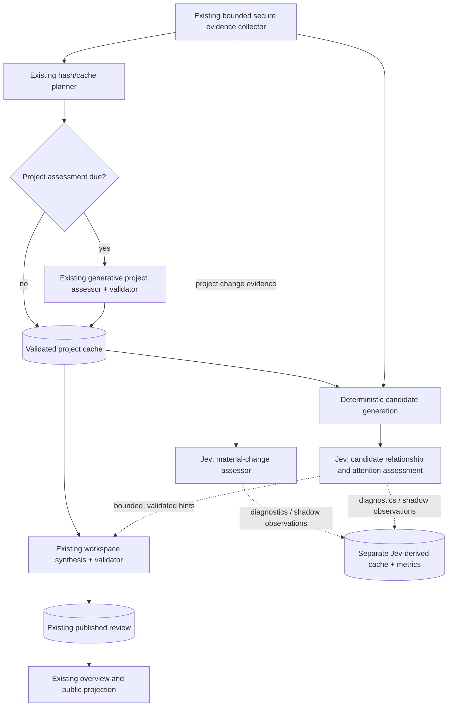

# OK Workbench — Jev-assisted workspace assessment

**Status:** Proposed implementation specification; not evidence that the feature exists.  
**Prepared:** 2026-09-27  
**Scope:** Workspace overview/review only. Project-level task housekeeping, chat routing, RAG, and post-edit checks are separate future work.  
**Target repository:** <https://github.com/edoloughlin/ok-workbench>

## 0. Purpose and implementation contract

Introduce an **optional, read-only semantic decision layer** using TypeSafe's Jev alongside the existing workspace-review pipeline. It should improve detection of material changes, candidate cross-project dependencies, conflicting evidence, competing attention demands, and the value of clarification questions. Its first deployment is **shadow mode**: run assessments and measure results without changing the published review, cache invalidation, priorities, or scheduler decisions.

Retain the existing architecture: deterministic evidence collection and hashes → independently cached generative project assessments → bounded generative workspace synthesis → validated persisted review → local public projection. Jev returns narrow typed assessments for ordinary code and/or the existing synthesis stage to consume. It is **not** the workspace reviewer, a source of project facts, an author of prose, or an authority for file access.

### Normative language

**MUST / MUST NOT** are required. **SHOULD** is a strong preference. **MAY** is optional. Each phase has a stop gate. Do not implement later phases before its gate is satisfied and the user instructs Codex to proceed.

### Existing documents, in precedence order

1. `docs/WORKSPACE-OVERVIEW-SPEC.md`: product behaviour, evidence honesty, priority versus urgency, feedback, UX, privacy, security.
2. `docs/WORKSPACE-REVIEW-RELIABILITY.md`: later amendment governing two-stage orchestration, independent caches, retry/accounting, budgets, partial results, and publication.
3. Current source/tests: source is definitive about what is *actually implemented*. A disagreement between documentation and runtime MUST be reported at Phase 0, not silently resolved by assuming either is current.
4. **This specification** adds optional Jev decision assistance; it does not supersede any existing safety, product, or reliability requirement.

Read these before code changes: `src/workspace-review.js`, `src/workspace-review-pipeline.js`, `src/workspace-review-schema.js`, `src/workspace-review-store.js`, relevant workspace review/server routes in `src/server.js`, `src/public/app.js`, and the existing review/unit/fixture/HTTP/security tests. The September 23 amendment specifically names `test/workspace-review-fixtures.mjs`. Verify actual test filenames in the checkout before editing.

## 1. Decisions to preserve

1. **The present generative project assessment and synthesis remain authoritative.** Jev can supply hints and reason-to-investigate signals; it cannot unilaterally publish a trajectory, lifecycle, priority, blocker, focus project, due date, improvement, or attention item.
2. **Stage 1 is project-isolated.** A project assessor MUST NOT receive other projects' evidence or Jev-inferred cross-project claims. Cross-project Jev assistance belongs between validated project assessments and synthesis. A pre-stage-1 change check may see only its project, its prior assessment and permitted shared guidance.
3. **Workspace review stays read-only.** Jev has no filesystem, shell, Git, browser, chat, or agent-tool access. It cannot authorise writes or broaden existing model/tool permissions.
4. **No second source of truth.** Existing document excerpts and validated assessments remain evidence. Jev results are derived, versioned, discardable observations with references to already collected sources; they are not project facts or OKF documents.
5. **Deterministic behaviour stays deterministic.** Content hashes, inclusion/exclusion, exact dates and runway, deadline urgency floors, user overrides, snooze/expiry, activity counts, quotas, ordering invariants, and permission checks remain in code. Jev MUST NOT compare dates or infer effort/hours from activity counts.
6. **Existing evidence rules remain binding.** A substantive claim must be supported by original-document excerpts under the existing validation contract. Jev's selected option, numerical answer, or paraphrase is NOT a citable source. A project summary is not substituted for original evidence where the existing contract requires a quote.
7. **No silence-as-failure inference.** Missing or old evidence may cause `unknown` or a request for update. An unchanged file, a quiet project, or activity allocation alone cannot establish drift, inaction, or failure. Waiting and parked projects retain their existing treatment.
8. **User intent wins.** Guidance, overrides, parking, feedback, suppression, and explicit commitments keep their existing precedence. Jev MUST NOT revive dismissed attention or override a deliberate pause.
9. **Honest freshness and coverage.** Stale/fallback project assessments retain their original timestamps and cannot substantiate new portfolio claims. Jev results associated with superseded source keys cannot be published as current. A Jev outage cannot disguise missing generative-review coverage.
10. **Fail open to the existing *review pipeline*, fail closed for security/privacy.** If Jev is unavailable, malformed, unconfigured, or over budget, proceed with the unchanged authorised generative review. If outbound disclosure is not authorised, do not make the Jev request at all.
11. **Local-first and opt-in.** Browsing and saved review display never require Jev. Disabled/manual review behaviour MUST NOT silently create Jev calls. Separate, explicit consent is needed to transmit workspace content to the Jev provider, even if a generative provider is configured.
12. **Budget and cancellation integrity.** Jev calls have their own explicit call/token ceilings and retry policy; they do not consume, reset, evade, or silently replace the existing generative provider-call limit. Propagate the current review abort signal. Old jobs cannot publish or clear newer pending-change flags.
13. **Implementation style.** Retain Node/CommonJS and the plain browser frontend. Prefer built-in `fetch` to a new runtime SDK dependency, unless Phase 0 establishes a concrete reason otherwise. Do not edit `dist/` by hand; generate it using the build.

## 2. Target architecture



**Phase-dependent arrows:** In shadow mode, Jev never influences `P`, `S`, `PUB`, or `UI`. When explicitly promoted, `J2` may supply bounded hints to `S`; `J1` may supply a *reason to refresh* but MUST NOT suppress a review currently required by hashes, cadence, deadlines, guidance, or user request. Promotion is a later, separately gated phase.

### Code boundaries (proposed names, subject to Phase 0 inspection)

| Component | Responsibility |
| --- | --- |
| `src/workspace-jev.js` | Provider-neutral decision port and Jev HTTP adapter; strict response parsing; timeout/abort; safe error classification. |
| `src/workspace-jev-questions.js` | Versioned, pure preparation of minimal state and closed-choice/noul questions for each decision family. |
| `src/workspace-jev-policy.js` | Pure, deterministic interpretation, eligibility, bounds, fallback, and confidence/threshold policy. |
| `src/workspace-jev-store.js` **or** carefully scoped addition to existing store | Workspace-scoped derived results and counters; atomic, permission-restricted storage, pruning, removal/redaction. |
| Existing pipeline | Only orchestration and optional injection of validated, bounded hints; no HTTP parsing or Jev policy inline. |
| Existing schema/validator | Keep public review authority; validate any optional internal hint independently; never accept model-invented source IDs. |

Names are suggestions, not instructions to duplicate an existing abstraction. Prefer a smaller seam if the checkout already provides it.

## 3. Decision families

### D1 — Material-change significance (first experiment)

**Input:** Prior validated project assessment; old/new selected evidence metadata and minimal changed excerpts; affected project instructions and source IDs; deterministic change reasons. Do not pass unrelated projects.

**Questions:** Did changed evidence introduce or resolve a blocker? Contradict the recorded outcome/next action? Alter a recorded commitment? Make the prior assessment potentially misleading? Is the difference solely editorial? Phrase each as an independent, direct yes/no question.

**Output:** Typed probabilities plus derived `investigate`/`no_observed_impact` classification from code. `no_observed_impact` MUST NOT mean no refresh required. A date/cadence/user override trigger always remains authoritative.

**Use:** Compare against the existing refresh decision and human-labelled change significance. In the optional later assisted mode, *positive* material-change signals MAY request a normal bounded refresh sooner; negative signals MUST NOT suppress a current required refresh without a separate spec and acceptance gate.

### D2 — Candidate cross-project relationships

**Input:** Pair of *current validated* project assessments and bounded supporting original excerpts, with stable project/source IDs. Generate pairs deterministically from explicit OKF links, named dependencies, shared outcome terminology, or validated project-level attention candidates. Similar terminology is candidate discovery, not proof of a dependency.

**Questions:** Is there an explicit or well-supported dependency? Would one project's documented deliverable unblock the other? Is there evidence of conflicting decisions/commitments? Is this merely topical overlap?

**Output:** Derived relationship candidates `{fromProjectId,toProjectId,kind,sourceIds,decision,policyVersion}` where `kind` is a closed enum such as `blocks`, `depends_on`, `possible_conflict`, `overlap`; uncertainty is a first-class outcome. Verify both projects are eligible and their source anchors exist; never fabricate quotes.

**Bound:** At most 20 selected projects under the current synthesis ceiling; at most **24 candidate pairs per run** initially, generated with stable sort and a fair rotation for overflow. Never perform unrestricted O(N²) model calls. One Jev request MAY batch several *questions about the same pair*. Do not batch unrelated pairs into one giant state that loses attribution.

**Use:** Initially diagnostics only. Later, supply candidate relationships to synthesis clearly marked *unverified*, with original excerpts; do not add them to the persistent OKF knowledge base. A user-confirmed relationship would require a separate user-driven product feature and is out of scope.

### D3 — Attention and clarification assistance

**Input:** Current stage-1 candidates, existing guidance, actual user overrides, effective time facts from code, suppression/feedback state, and a bounded comparison projection. No raw activity ledger is needed where deterministic allocation facts suffice.

**Questions:** Is the candidate actionable now? Is more information required to act safely? Is its claimed consequence supported by the evidence pack? Would clarification plausibly change the top action/urgency? Can one candidate's completion unblock another?

**Output:** Advisory signals per already-existing candidate, not an independently generated priority list or free-text briefing. Use candidate IDs generated by the server. For question selection, the generative synthesiser MUST originate the question and options; Jev can assess bounded candidates but cannot invent the question text or its evidence.

**Use:** A later synthesis prompt may consume validated hints as optional inputs. It MUST follow the existing `focus`/`next`/`maintain`/`parked` and `now`/`soon`/`watch` distinction, deadline floors, and at-most-one-question limit. Do not invent a composite priority score or show Jev probabilities in the UI.

### D4 — Consistency warning (optional future extension)

Assess whether the **proposed** synthesis contradicts current validated project assessments or evidence. Such a result may trigger an investigation within the existing correction-attempt budget; it cannot auto-correct text, turn an invalid review into a valid one, or add provider calls beyond the existing limits. Only implement after D1–D3 are measured. Existing strict structural and quote validators remain authoritative.

## 4. Decision port and API contract

Use a narrow, testable interface in the current JavaScript stack:

```js
// Conceptual shape, not a mandatory exact filename/export.
// Caller owns the original source snapshot and checks it again before use.
async function assessDecision({ family, state, questions, inputKey, signal }) {
  // -> { status: 'ok', resolvedModel, answers, usage, inputKey,
  //      questionVersion, providerVersion, assessedAt }
  // -> { status: 'unavailable' | 'disabled' | 'budget_exhausted', safeReason }
}
```

Native TypeSafe endpoint (verify in Phase 0 against its current official documentation):

`POST https://api.typesafe.ai/v1/systemone` with Bearer authentication, `model`, `state`, and a map of typed `questions`. The official question types are `noul` (yes/no probability), `choice` (closed options and distribution), and `score` (ordered levels). Prefer `noul` and `choice` for this specification; do not use a fractional `score` as a project-health grade.

Illustrative D1 request (not a sample real user project):

```json
{
  "model": "jev-latest",
  "state": {
    "projectId": "project-a",
    "previous": { "nextAction": "Complete authentication integration" },
    "change": {
      "sourceId": "source-17",
      "before": "Authentication integration is in progress.",
      "after": "Authentication integration is complete. Deployment remains blocked by an external approval."
    }
  },
  "questions": {
    "newBlocker": {
      "type": "noul",
      "instructions": "Does the new project evidence state a present blocker that was not present in the old evidence?"
    },
    "nextActionChanged": {
      "type": "noul",
      "instructions": "Does the new project evidence make the previous next action outdated?"
    },
    "reviewScope": {
      "type": "choice",
      "instructions": "Which existing review area is most clearly affected by the new evidence?",
      "criteria": {
        "next_action": "The recorded next action",
        "blocker": "The recorded blocker",
        "both": "Both next action and blocker",
        "neither": "Neither is supported by this change",
        "insufficient": "The excerpts are insufficient to decide"
      }
    }
  }
}
```

The values above are illustrative; real adapters MUST use the actual official response shape and reject missing or unknown answer keys, invalid types, invalid enum values, non-finite numbers, out-of-range probabilities, and inconsistent source keys. Noul answers have a `noul` field; do not assume they have a `confidence` field. A `choice` confidence value describes concentration of its output distribution; do not treat it as measured real-world correctness.

**Always provide a route for insufficient evidence.** A forced `choice` without `insufficient`/`none` is unacceptable where the supplied evidence may genuinely not decide the matter.

For each request: enforce modest local serialized-byte/token-estimate caps *below* the official model maximum, maximum response bytes, a bounded timeout, retries for rate limit/temporary provider outage only, cancellation, and the existing app's secret-handling conventions. Do not build a client around an unofficial Jev reseller endpoint. Pin the model version for benchmark and promotion; treat `jev-latest` as a development alias only.

## 5. Derived data and caching

Maintain a cache separate from the canonical project results and published review. Suggested record:

```json
{
  "schemaVersion": 1,
  "family": "material-change",
  "inputKey": "sha256-of-canonical-effective-input",
  "projectIds": ["project-a"],
  "sourceIds": ["source-17"],
  "assessmentKeys": ["validated-project-result-digest"],
  "questionVersion": 1,
  "policyVersion": 1,
  "provider": "typesafe",
  "resolvedModel": "pinned-version-from-provider",
  "assessedAt": "2026-09-27T12:00:00Z",
  "answers": {},
  "derivedSignals": {},
  "usage": { "input_tokens": 0, "output_tokens": 0 }
}
```

Keys must include workspace identity, included project IDs, original excerpt hashes, relevant assessment digests, guidance/controls where consumed, model identity, question/policy versions, and relevant time-trigger bucket. Canonicalize and hash using existing helpers. Do not hash access time, job ID, or arbitrary wall-clock seconds. A source selection/coverage change may matter even if the visible text seems similar.

- Store under the existing workspace-scoped state directory, not in the portable workspace/OKF documents or Git.
- Use safe generated filenames, atomic writes, restrictive permissions, and existing workspace write serialisation.
- Bound record count and storage. Prune removed/excluded projects promptly and redact them from **all** derived relationships, diagnostics, outputs, and nested records, not just visible rows.
- Failed Jev attempts must not overwrite a good result. A cache hit must not advance the original assessment timestamp.
- Never reuse candidate relationships if either project's evidence, membership, assessment digest, or relevant user guidance has changed.
- Shadow data is not permitted to alter normal project or synthesis cache keys. In assisted mode, only the *bounded, actually consumed* validated hints and versioned hint policy belong in the synthesis dependency key. Avoid a self-invalidating loop where Jev evaluates the just-published synthesis as a new input forever.
- Persist only minimum necessary data: input hash, bounded signals, source IDs, model/version and usage. **Do not persist raw Jev input, raw provider responses, secret-bearing errors, or private project excerpts in analytics/diagnostic logs.** Existing permitted source snapshots continue to follow existing review-store rules.

## 6. Privacy, security, budgets and failure semantics

### Consent and provider configuration

Jev must be disabled by default. Present separate disclosure: selected project excerpts, saved project assessments and applicable workspace guidance may be sent to TypeSafe, in addition to the separately configured generative provider. Configuring an API key does not itself enable automatic sending. Allow disabling without deleting or invalidating the last good *generative* review; offer a clear way to remove Jev-derived diagnostic records.

Use the application's established provider secret path or a dedicated server-side `TYPESAFE_API_KEY`; never put credentials in root/project Markdown, browser storage, static assets, logs, traces, or tools. If credential UI is introduced, reuse existing secret-handling controls; do not expose the key to the frontend. Do not create an alternate network path through sandbox workers or workspace tools.

### Minimum budgets and error handling

- **Shadow defaults:** no requests unless the user opts in, and no automatic Jev calls when workspace automatic monitoring is disabled; allow an explicit manual benchmark trigger.
- **Initial cap after opt-in:** configure a separate rolling 24-hour maximum of **30 Jev requests** and **120,000 Jev input tokens**, with at most **2 concurrent** Jev requests. These are conservative starting limits, not claimed provider limits; make them adjustable only within safe server-owned maxima.
- Preserve the existing rolling `dailyAutomaticLimit` semantics for generative project/synthesis/correction calls (documented default: 6). Jev cannot consume the reserved synthesis attempt or bypass it by invoking a different code path.
- Account for Jev usage separately: requests, input/output tokens, retry count, elapsed time, cache hits, provider/model, and safe error category. Do not derive a price in code from a mutable marketing number; if costs are shown, store the rate/configuration date and mark estimates.
- Distinguish `disabled`, `consent_missing`, `not_configured`, `budget_exhausted`, `rate_limited`, `timeout`, `invalid_response`, `provider_unavailable`, `aborted` and `superseded`. Show only safe aggregate status in UI.
- `401`/`422` are configuration/contract errors, not transient retries. Retry eligible `429`/temporary provider errors within the Jev budget with bounded backoff; never retry an aborted/superseded job.
- Provider failure MUST leave the existing review usable and must not convert a validated project into an unknown one. No prompt/output logs that leak content.

### Threat model

Treat all project content as untrusted input, including text that impersonates developer instructions or asks Jev to favour a particular project. Questions and criteria are assembled only from server-owned templates. Never allow documents to inject their own questions, thresholds, options, endpoint, model, or access scope. Jev's constrained output does not make its judgment a security control. Source IDs and project membership are resolved and verified by code.

## 7. Evaluation plan and promotion rules

The absence of a public live-model benchmark for this particular use is a design constraint, not a reason to invent confidence thresholds. Start by measuring both existing outcomes and Jev against independently labelled examples.

### Fixture corpus

Use existing workspace-review fixtures and add a dedicated Jev suite with at least the following contrasts:

| Scenario | Ground truth that must be represented |
| --- | --- |
| Editorial-only change | No material change; deterministic cache still invalidates if selected content changed. |
| New/resolved blocker | Material change with original supporting excerpt. |
| Completed task + new next action | Old next action may become obsolete. |
| Explicit deadline approaches without edit | Deterministic time trigger, not Jev's date arithmetic. |
| Missing/stale/contradictory project evidence | `unknown`/update request, not invented progress or drift. |
| Waiting/parked/snoozed project | Respect revisit and feedback. |
| Cross-project explicit dependency | Link to both source excerpts, directed relationship. |
| Shared vocabulary only | No invented dependency. |
| Contradictory project decisions | Flag for inspection; no auto-resolved truth. |
| Lower-tier project with imminent commitment | Urgent item without promoting its strategic priority. |
| Strategic project with current positive outcome and quiet log | Do not infer inactivity or drift. |
| Adversarial source text | Does not override server question/criteria or permissions. |
| Excluded/deleted project | No cached relationship, hints, or leaked data. |
| Provider error, quota, abort, late response | Existing review and publication guarantees remain intact. |

Use both synthetic fixtures and a *separately authorised* set of real project change examples. Label examples without seeing Jev's outputs; record ambiguous cases explicitly. Include false-negative and false-positive costs, not just aggregate accuracy. Keep a held-out portfolio for promotion evaluation; do not repeatedly tune on it.

### Metrics

- **Material-change recall:** especially evidence-backed blockers, invalidated next actions and commitments.
- **False-warning rate:** how often editorial changes or topical overlap generate portfolio warnings.
- **Relationship precision/recall:** correctly directed, supported cross-project links; distinguish `none` and `unknown`.
- **Portfolio recommendation agreement/disagreement:** with reference judgments, user guidance and existing validated output; investigate disagreement rather than treating either model as truth.
- **Consistency/quote validity:** no Jev-sourced invented dates, completions, dependencies or source IDs in published output.
- **Cost and latency:** end-to-end review time and cost, Jev calls/tokens, generative calls/tokens, cache reuse, errors and aborts. Compare against the unchanged two-stage pipeline.
- **Privacy/control correctness:** zero unauthorised outbound requests, zero excluded-project leaks, zero review publication after supersession.

### Non-negotiable promotion gate

Do not advance a decision family beyond shadow mode until its representative test set includes all required negative/adversarial cases, tests pass, baseline and Jev metrics are documented, and the user approves the explicit scope of promotion. Any missed **critical** labelled event (e.g. a newly evidenced deadline-threatening blocker) blocks the introduction of a *suppression* gate. Passing a finite sample does not prove zero real-world miss rate; keep monitoring and an immediate rollback switch. No automatic review suppression is authorised by this specification.

## 8. Phased implementation and Codex stop points

**General execution instruction to Codex:** Implement exactly one phase per invocation. Read the current repository state and precedence documents first. Do not silently implement later phases or rewrite entire subsystems for tidiness. Preserve complete existing files and public schemas unless this phase explicitly requires a compatible additive change. At the end of each phase, report files changed, tests run/results, observed gaps, any provider calls/cost, and the *next phase*, then STOP. Do not claim a live-model result if you only used a fake adapter.

### Phase 0 — Baseline and integration map (no feature behaviour change)

1. Inspect the source and current workspace-overview implementation; identify actual stage boundaries, collector snapshots, cache keys, provider adapters, cancellation and settings/secret paths.
2. Read the current TypeSafe official API/schema, model IDs, privacy terms and limits before writing a live adapter. Record any change from the example in Section 4.
3. Record baseline fixture-test results, present provider-call accounting, default limits, and the observable existing review failures/latency (if any). Do not imply that the 2026-09-22 measurements describe the user's current installation.
4. Define concrete code integration points and minimal new tests in `docs/` or the implementation PR description. Identify the owner's decision required for outbound Jev data sharing.

**Deliverable:** Short integration-map Markdown, no working Jev request, no public API/UX change.  
**Stop gate:** `npm run build && npm test` passes (or pre-existing failures documented) and code owners can identify precisely where Jev may be inserted without compromising stage isolation.

### Phase 1 — Decision port and offline contract tests

1. Add the provider-neutral port, optional TypeSafe HTTP adapter, versioned question templates, input bounds and strict response validator.
2. Add a fake adapter to test noul/choice distributions, insufficient-evidence answers, timeouts, retry codes, cancellation and malformed responses. No live credentials required.
3. Add disabled-by-default settings and safe credential handling. Separate Jev budget counters from generative-call counters; support manual *explicit* dry-run only after consent.
4. Prove disabled mode creates no Jev network requests and leaves output/cache keys unchanged.

**Deliverable:** Internal feature seam with no published-review changes.  
**Stop gate:** Build and existing tests pass; new contract/security tests pass; no Jev activity in disabled mode. Do not yet call Jev from normal reviews.

### Phase 2 — Material-change assessment in shadow mode

1. Construct narrow old/new evidence cases at the existing hash-change boundary. No cross-project state in D1.
2. Add bounded, abortable Jev calls after explicit opt-in; emit derived records into separate state and aggregate metrics only.
3. Run D1 on fixture and labelled examples. Retain all existing invalidations, project refreshes and synthesis behaviour regardless of Jev answer.
4. Add diagnostics for disagreement without putting probabilities into end-user priority/health chips.

**Deliverable:** Repeatable D1 benchmark and a demonstration that project/synthesis calls and published reviews are unchanged.  
**Stop gate:** Evidence that a negative Jev answer never suppresses required review, and comparison results on labelled data. Stop for user evaluation.

### Phase 3 — Cross-project relationship candidates in shadow mode

1. Generate bounded deterministic pairs **after** project validation, from current selected projects only; cap pairs and rotate overflow fairly.
2. Assess D2 using original excerpts from both projects; distinguish unsupported overlap from directional dependencies.
3. Verify source anchors, project eligibility, source revision, source hashes and pair input keys before persisting diagnostics; remove excluded/deleted-project signals promptly.
4. Evaluate against explicit dependencies, overlap-only false positives, contradictory decisions and adversarial content.

**Deliverable:** Evidence-linked, derived relationship diagnostics; no OKF writes and no synthesis changes.  
**Stop gate:** Labelled precision/recall and false-positive findings reviewed by user. Do not automatically publish a relationship graph.

### Phase 4 — Portfolio attention and question assessment in shadow mode

1. Build D3 cases from stage-1 current validated candidates, real effective guidance, code-computed runway and existing suppression.
2. Evaluate actionability/attention impact and clarification impact. Preserve independent priority, trajectory, urgency, lifecycle and evidence-state dimensions.
3. Test competing urgent/strategic projects, parked/waiting projects, evidenced deadlines, repeated deferrals and cases where no question is warranted.
4. Compare suggested attention/question eligibility with reference judgments and existing synthesis, without replacing synthesis or adding UI advice.

**Deliverable:** D3 benchmark showing impact or lack of impact on attention selection.  
**Stop gate:** User decides whether measured benefit warrants any live integration. If the benefit is marginal, stop the project here.

### Phase 5 — Optional assisted synthesis, limited promotion

**Only after explicit approval of Phase 2–4 results.**

1. Add a **versioned, bounded, clearly advisory** Jev hint pack to the existing synthesis input. Hints may flag contradictions and suggest relationships/questions to inspect; they do not assign final project priority or override user controls.
2. Source-backed hints must include current project/source IDs and original validated excerpts. The final synthesis validator remains unchanged in authority: no Jev probability may satisfy a required claim quote.
3. Include only actual consumed hints and their versions in the synthesis cache key. Recheck all relevant snapshots and settings before publication.
4. Keep a feature flag permitting immediate fallback to baseline synthesis and verify equal behaviour when disabled or Jev fails.
5. Add end-to-end tests for no duplicate calls on unchanged inputs, no self-invalidation, cancellation, cap exhaustion, one-question maximum, no cross-project stage-1 leakage and project exclusion during an in-flight job.

**Deliverable:** Opt-in advisory-assisted workspace synthesis and documented before/after comparison.  
**Stop gate:** Existing functional/security acceptance suite passes; held-out portfolio does not regress on critical claims, user-control precedence or partial-result semantics. Stop and obtain deployment approval.

### Phase 6 — Optional guarded positive refresh routing (separate approval)

Only consider if Phase 2 demonstrates clear recall on material events and a useful incremental benefit. Permit positive D1 signals to queue an existing, bounded review sooner than cadence would otherwise require. Existing change/fingerprint/due/manual triggers still operate. Do not give Jev the authority to mark changed evidence as fresh or remove an outstanding review requirement.

**Deliverable:** Faster identification of meaningful situations *where the current scheduler would otherwise defer*, if such situations exist in the measured baseline.  
**Stop gate:** Demonstrate real incremental benefit rather than adding redundant provider calls. If the existing scheduler already refreshes promptly, omit this phase.

## 9. Acceptance checklist (apply throughout)

- [ ] With Jev disabled or unavailable, the normal workspace review has the same user-visible output and provider-call plan for the same deterministic inputs.
- [ ] Stage-1 calls remain project-isolated; cross-project data appears only after validation and only in synthesis-side assistance.
- [ ] No Jev answer can grant access, write files, replace source excerpts, bypass user controls, or set final priority/lifecycle/trajectory.
- [ ] Hash/cadence/deadline/manual triggers are never suppressed by a negative Jev decision.
- [ ] Unchanged manual requests and repeated GETs cause no unnecessary Jev calls or self-invalidating synthesis.
- [ ] All reference IDs, quotes and project memberships are validated against current source snapshots.
- [ ] Stale/unavailable project assessments do not support new substantive attention; old timestamps remain visible.
- [ ] No claim about progress/drift is based on inactivity or allocation counts alone.
- [ ] No question is generated solely because Jev requests one; existing one-question/product rules hold.
- [ ] Separate Jev consent, calls/tokens budget, abort and error fallback work across restart.
- [ ] No private excerpts, API keys, provider responses or unsafe errors leak into browser assets/logs/diagnostics.
- [ ] Deleted/excluded projects vanish from derived records and public projections.
- [ ] Existing `npm run build && npm test` passes; add applicable integration tests and `npm run test:e2e` when UI is touched.
- [ ] All model-evaluation claims distinguish fake-provider tests from real pinned-model measurements.

## 10. Source references and review date

**Repository/specifications consulted 2026-09-27:**

- <https://github.com/edoloughlin/ok-workbench>
- <https://github.com/edoloughlin/ok-workbench/blob/main/docs/WORKSPACE-OVERVIEW-SPEC.md>
- <https://github.com/edoloughlin/ok-workbench/blob/main/docs/WORKSPACE-REVIEW-RELIABILITY.md>
- <https://github.com/edoloughlin/ok-workbench/blob/main/src/workspace-review.js>
- <https://github.com/edoloughlin/ok-workbench/blob/main/src/workspace-review-pipeline.js>
- <https://github.com/edoloughlin/ok-workbench/blob/main/src/workspace-review-schema.js>
- <https://github.com/edoloughlin/ok-workbench/blob/main/src/workspace-review-store.js>

**TypeSafe primary documentation consulted 2026-09-27:**

- <https://typesafe.ai/blog/introducing-system-one-models-and-jev>
- <https://docs.typesafe.ai/api>
- <https://docs.typesafe.ai/primitives>
- <https://docs.typesafe.ai/confidence>
- <https://docs.typesafe.ai/model-jaggedness/jev-1.13>

**Implementation note:** Re-read these sources against the actual checkout and official API at Phase 0. This specification deliberately does not claim that a Jev provider has been tested with the user's credentials or that its expected model-quality improvements have been measured.
